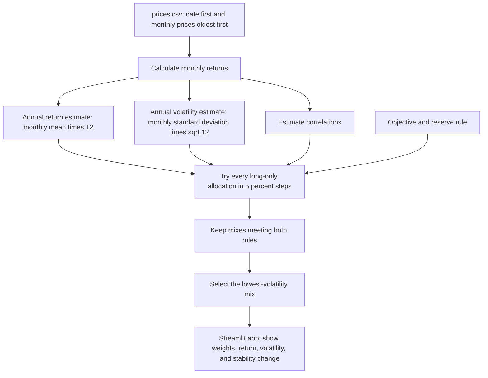

# Lab 15 — Portfolio Stability Decision

## Meridian training verification

The app searches long-only allocations in 5-point increments for the lowest-volatility mix that meets a 6.5% expected-return objective and a 3% reserve-eligible minimum.

| Run | Bills / 10-year / IG / equity | Expected return | Volatility |
|---|---|---:|---:|
| As loaded | 0 / 20 / 25 / 55 | 6.51% | 9.44% |
| Equity return estimate changed from 8.0% to 7.0% | 0 / 10 / 10 / 80 | 6.53% | 12.94% |

Largest weight change: 25 percentage points.

An engine stress test with the investment-grade-bond / global-equity correlation temporarily set to 0.50 returns 0 / 40 / 0 / 60 at 6.52% expected return and 9.73% volatility. Complete the required app-refresh check by changing both correlation-table cells in `portfolio.py`, refreshing the app, and then restoring 0.25.

## Engine flowchart

## My universe and data sources

My universe contains four long-only ETFs. The app uses `prices.csv`, which contains Yahoo Finance monthly adjusted-close prices from October 2021 through October 2026, ordered oldest first.

| Ticker | Portfolio role | Price source | Download date |
|---|---|---|---|
| SGOV | Cash and reserve: 0–3 month U.S. Treasury bills | [Yahoo Finance historical data](https://finance.yahoo.com/quote/SGOV/history/) | 2026-10-22 |
| VGIT | Government bonds: intermediate U.S. Treasuries | [Yahoo Finance historical data](https://finance.yahoo.com/quote/VGIT/history/) | 2026-10-22 |
| VCIT | Fixed income: intermediate investment-grade corporate bonds | [Yahoo Finance historical data](https://finance.yahoo.com/quote/VCIT/history/) | 2026-10-22 |
| ACWI | Equity: broad global stock index | [Yahoo Finance historical data](https://finance.yahoo.com/quote/ACWI/history/) | 2026-10-22 |

Returns are historical estimates from five years of monthly adjusted-close prices, not forecasts.

## My mandate and results

- Objective: 6.5% expected return estimate.
- Hard constraint: at least 3% in reserve-eligible Treasury assets (SGOV and VGIT).
- All-month result: 60% SGOV / 0% VGIT / 0% VCIT / 40% ACWI; estimated return 6.61%; volatility 5.99%.
- Last-36-month result: 85% SGOV / 0% VGIT / 0% VCIT / 15% ACWI; estimated return 6.87%; volatility 1.76%.
- Largest weight change: 25 percentage points.

## Partner attack and my call

- Partner attack: My partner lowered ACWI's expected-return estimate by one percentage point. The lowest-risk mix changed from 60% SGOV / 40% ACWI to 55% SGOV / 45% ACWI, a 5-point change.
- My call: Pilot, not adopt: the recommended mix changes when an expected-return estimate changes, and it also changed 25 points between the full five-year sample and the last 36 months. I would consider adoption only after validating the return assumptions and reviewing why the recent-period result puts much more weight in SGOV.
- Estimation risk: Estimation risk is the risk that historical averages are poor forecasts of future returns, volatility, or correlations. The optimizer treats small differences in those estimates as meaningful, so it can move money sharply toward the asset that appears to meet the target with the least risk; my 25-point shift between samples shows that dependence on the chosen history.
